Vidar is a malware family targeting Windows systems that was first identified in late 2018. Due to its strong similarities to the Arkei Trojan, security researchers believe it may be an updated or derivative version of Arkei. Vidar is primarily an information stealer, specializing in the theft of browser-stored credentials, cookies, and cryptocurrency wallet data. Over time, it has evolved significantly in both its capabilities and delivery methods. Initially, it was mainly distributed through phishing emails, often as ISO attachments, and was also used as a dropper to deliver additional malware, including the GandCrab ransomware. Consequently, several security analyses have classified Vidar as part of multi-stage malware campaigns focused on financial fraud and information theft.

Like many other malware families, Vidar operates under a Malware-as-a-Service (MaaS) model and has been advertised on underground marketplaces on both the Dark Web and Telegram since its emergence. Historical advertisements indicate that its selling price has changed over the years. During this investigation, archived listings were found offering the same "VIDAR Pro stealer" for US$450 and US$700, while more recent advertisements offer a lifetime license for approximately US$300.

As mentioned previously, Vidar has been involved in a large number of malware campaigns in recent years. During my research, I observed that the latest versions have evolved in an attempt to improve evasion techniques. In particular, the introduction of a Go-based packer has made Vidar more difficult to identify, leading some analysts to confuse it with StealC due to similarities in their packed binaries.

## Technical analysis
Vidar has maintained a persistent presence in the malware landscape since its emergence, consistently ranking among the most prevalent information stealers. As a result, thousands of samples have been collected over the years, revealing continuous changes in its behavior, functionality, and delivery techniques. More recently, Vidar has been distributed through ClickFix campaigns, as well as through fake Roblox cheating tools and other fraudulent software. In addition, several campaigns have leveraged GitHub repositories to distribute counterfeit utilities embedded with the Vidar payload, exploiting the platform's legitimacy to deceive potential victims.

In summary, the infection begins with a Go-based loader that contains the Vidar payload. Once executed, Vidar establishes communication with its command-and-control (C2) server to retrieve the configuration data that specifies the information to be collected from the victim system. Finally, it downloads and executes an additional payload to continue the infection chain.

The following diagram illustrates the most representative Vidar variants identified in recent months.
<p align="center">
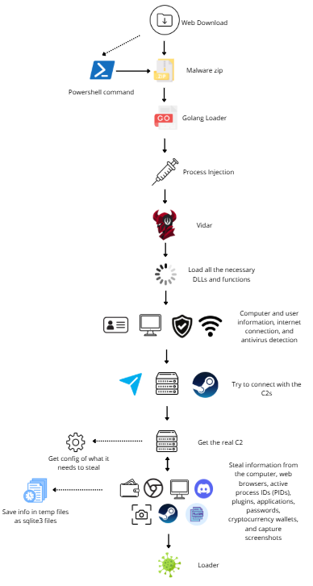
</p>

In recent months, multiple versions of Vidar have coexisted in the wild. Although a large number of samples are still based on version 2.0, newer variants such as versions 2.2 and 2.3 continue to be observed in active campaigns. During this research, the most recent version identified was Vidar 2.4.

In general, the initial stage of the infection depends on the distribution campaign. For example, ClickFix campaigns typically begin by executing a PowerShell command, whereas software crack campaigns usually rely on a malicious executable. In some cases, attackers also employ DLL sideloading to initiate the infection while evading detection.
<p align="center">
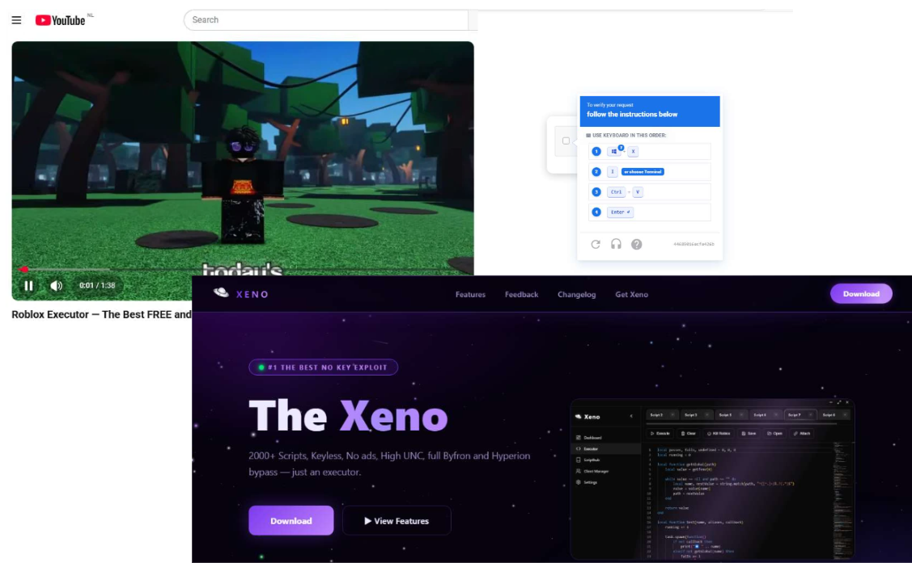
</p>

These examples illustrate the different delivery methods used to distribute Vidar. Depending on the campaign, the infection may begin with a PowerShell command copied to the victim's clipboard or with a compressed archive containing a malicious executable or DLL. Despite these differences in the initial access stage, the remainder of the infection chain follows the same pattern, as the primary objective is to execute the Go-based loader that deploys the Vidar payload.
<p align="center">
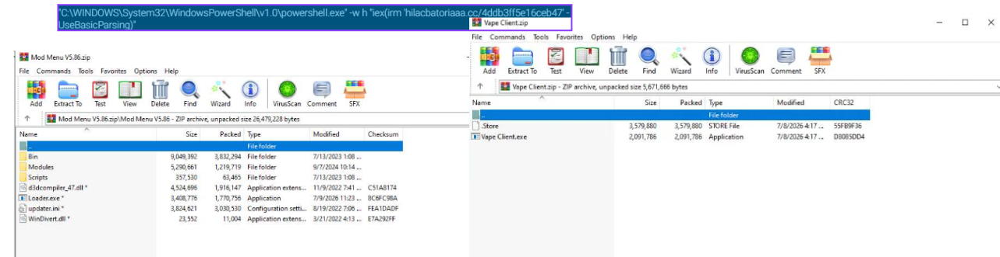
</p>

Although the Go-based loader follows the same execution flow across different samples, it conceals its malicious behavior by embedding large amounts of benign-looking strings throughout the code. During the analysis, I identified samples containing numerous strings written in both English and Cyrillic. While the presence of Cyrillic strings may indicate that some campaigns were intended for Russian-speaking users or other regions where the Cyrillic alphabet is commonly used, the coexistence of English-language samples suggests that this characteristic varies across campaigns and should not be considered a definitive indicator of the intended targets.

<p align="center">
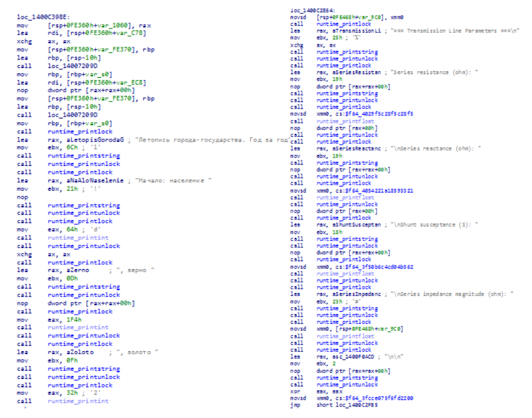
</p>

## First Stage
During the execution of the Go-based loader, the names of the required WinAPI functions are decoded, and the corresponding APIs are dynamically resolved. The loader then allocates a memory region within its own process to host the still-obfuscated Vidar payload. Once the memory has been prepared, it deobfuscates each section of the payload and copies them into the allocated memory before transferring execution to Vidar.
<p align="center">
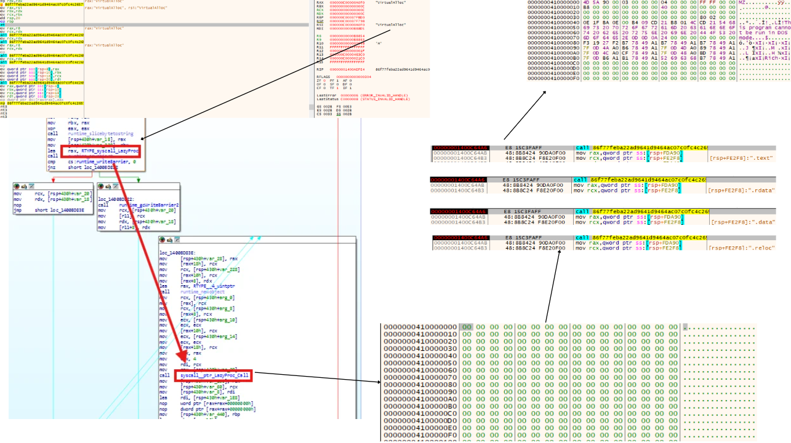
</p>


## Vidar
As demonstrated throughout this analysis, reaching the final Vidar payload requires traversing several consecutive execution stages, each designed to conceal the next and progressively reveal the malware's functionality. Although the extensive obfuscation techniques significantly increase the complexity of the analysis, the overall execution flow remains remarkably consistent across different samples.

Examining these samples over time also highlights the continuous refinement of the malware, reflecting the technical expertise of its developers. This combination of obfuscation, a stable architecture, and ongoing development may help explain why Vidar remains one of the most prevalent information stealers.

The extracted binary is typically a 64-bit C++ executable with a file size of approximately 2 MB.
<p align="center">
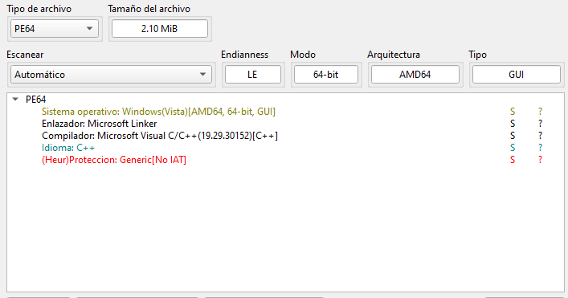
</p>

Starting with the static analysis, it was possible to extract valuable information about Vidar's internal configuration and execution flow. Among the extracted artifacts were several hardcoded command-and-control (C2) server URLs, the number of which varies depending on the sample. There are samples that only have 1 URL.These servers are used by Vidar to retrieve its configuration and maintain communication with the attacker-controlled infrastructure. In the sample shown below, three C2 URLs were identified.

<p align="center">
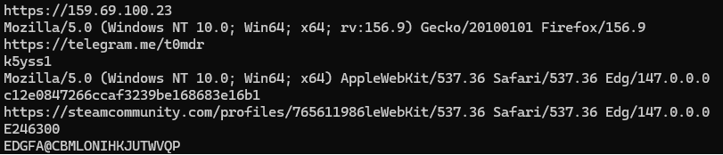
</p>

By examining one of the extracted URLs, it is possible to identify a reference to a Steam profile whose name appears to serve as a command-and-control (C2) identifier. The string `k5yss1` can also be observed immediately preceding the Steam profile URL. This identifier varies across samples and is used by Vidar to verify that it has reached the expected C2 server before retrieving its configuration. The purpose of this identifier and its role in the communication process are discussed in greater detail in the following sections.
<p align="center">
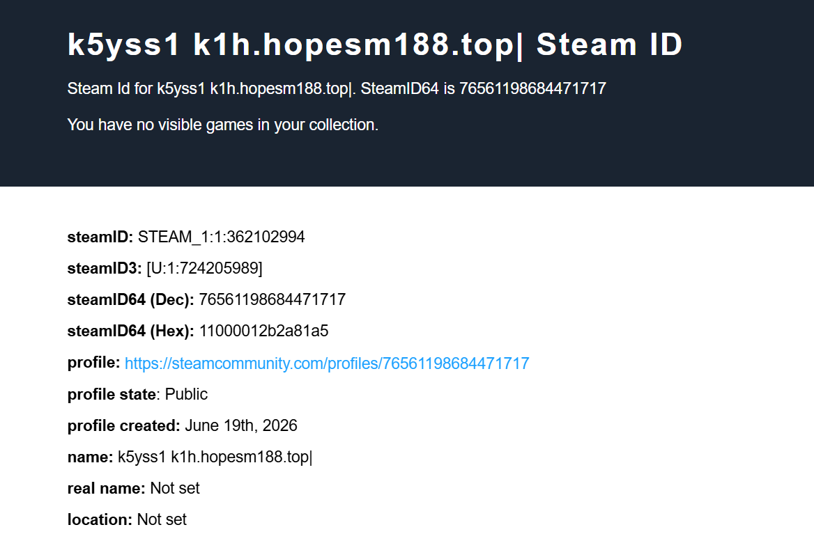
</p>

Regarding its dynamic behavior, the loader follows the well-established LoadLibraryA and GetProcAddress approach to dynamically resolve the libraries and WinAPI functions required during execution. This technique serves two main purposes: it conceals the APIs used by Vidar by avoiding static imports and complicates static analysis, while also helping the malware evade security solutions that rely on import-based detection mechanisms. The libraries it loads are:
- **kernel32.dll:** Used to perform basic system operations, including retrieving system information, managing memory, and accessing files.
- **ntdll.dll:** Used to invoke low-level Native API functions, reducing reliance on high-level WinAPI calls and potentially minimizing detection.
- **user32.dll:** Used to obtain information about the user environment and interact with the graphical user interface.
- **bcrypt.dll:** Used to encrypt and decrypt data, protecting the information before it is transmitted.
- **winhttp.dll:** Used to communicate with the command-and-control (C2) server over HTTP/HTTPS.
- **gdi32.dll:** Used to capture screenshots of the victim's desktop.

To reduce the likelihood of analysis or detection, the sample employs multiple evasion techniques. One of these consists of enumerating the running processes and comparing them against an internal list of known antivirus and security-related applications. The presence of any matching process influences an internal score used to assess whether the malware is executing in a monitored or sandboxed environment. The process names checked by the sample are:
- **Avast**
  - `avastsvc.exe`
  - `avastui.exe`
  - `aswengsrv.exe`

- **AVG**
  - `avgsvc.exe`
  - `avgui.exe`
  - `avgcsrva.exe`

- **Norton**
  - `nortonui.exe`
  - `nortonsvc.exe`

- **Malwarebytes**
  - `mbamtray.exe`
  - `mbamservice.exe`

- **Dr.Web**
  - `dwservice.exe`
  - `dwengine.exe`
  - `dwnetfilter.exe`
  - `spideragent.exe`

- **Bitdefender**
  - `bdservicehost.exe`
  - `bdagent.exe`

- **Trend Micro**
  - `tmlisten.exe`
  - `tmccsf.exe`
  - `tmbrsrv.exe`

- **Kaspersky**
  - `avp.exe`
  - `avpui.exe`
  - `kavfs.exe`

- **ESET**
  - `ekrn.exe`
  - `egui.exe`
  - `essod.exe`

- **Panda Security**
  - `pccntmon.exe`

- **McAfee**
  - `coreserviceshell.exe`

- **Symantec Endpoint Protection**
  - `ntrtscan.exe`

- **BullGuard**
  - `vsserv.exe`

- **Other security software**
  - `nlltoolssvc.exe`

Vidar then performs a series of environment checks to determine whether it is running in a legitimate system or within an analysis environment. These checks contribute to an internal scoring mechanism, and the malware only continues its execution if the accumulated score reaches at least 8 out of 13. Otherwise, the process is terminated.

| Check | Description |
|-------|-------------|
| `internet` | Network connectivity |
| `debugger` | Debugger present |
| `peb_flags` | PEB `BeingDebugged` flag |
| `cpus` | CPU core count |
| `rdtsc` | RDTSC timing delta |
| `modules` | Loaded module inspection |
| `ram` | Physical RAM size (GB) |
| `disk` | Disk size (GB) |
| `user` | Username blacklist |
| `av_sandbox` | Antivirus/security software detection |
| `pc` | Hostname blacklist |
| `uptime` | System uptime |

The blacklisted usernames are `john` and `WDAGUtilityAccount`. The blacklisted computer names are `john-pc` and `sandbox`.

The Vidar payload employs two mechanisms to determine whether it is already running on the compromised system. First, it attempts to create a mutex named `Gernsoalse`. If the mutex already exists, indicating that another instance of the malware is active, the process terminates. Next, it checks for the presence of the registry key `TS_aa6f515d` under `Software\Microsoft\Windows\CurrentVersion\Explorer`. If the key does not exist, Vidar creates it and assigns a randomly generated seven-character alphanumeric value matching the pattern `[A-Z0-9]{7}`.
<p align="center">
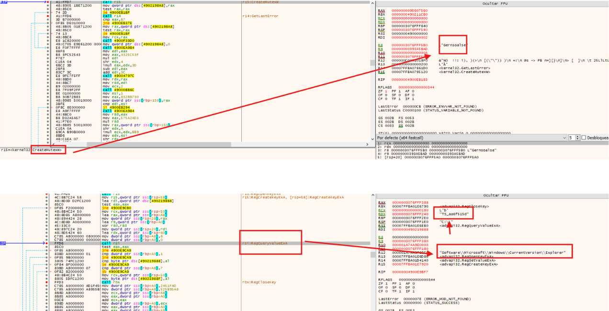
</p>

Before establishing any communication with the C2 server, Vidar creates a directory under `%TEMP%` using a randomly generated seven-character alphanumeric name that matches the pattern `[a-z0-9]{8}`. This directory is later used to store the encrypted files containing the stolen information.
<p align="center">
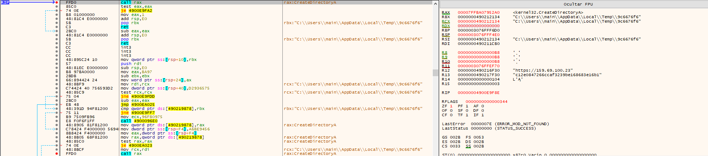
</p>

After completing its initial checks, Vidar establishes communication with the C2 server to notify the attacker-controlled infrastructure that the malware is active. This first communication is not limited to a simple beaconing request; it also includes information collected during the reconnaissance phase, such as the hwid. The C2 selection process follows a specific resolution flow. First, Vidar attempts to identify the appropriate C2 infrastructure through the configured IP address, followed by Telegram and, finally, the associated Steam account. Depending on the response received from the C2, the malware may modify its communication behavior. For instance, if the response contains the expected identifier string along with a domain, Vidar switches to this new C2 address for subsequent communications. Otherwise, it continues using the previously configured URL.
<p align="center">
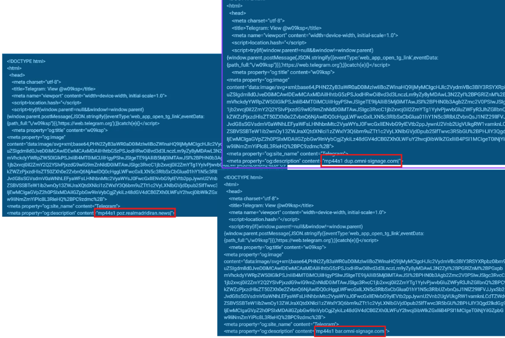
</p>

Additionally, the C2 server responds with an encrypted configuration that defines the data collection parameters, including the browsers from which Vidar should extract information. Some of the configured targets include:

```json
[
  {
    "browsers_name": "Google Chrome",
    "patch": "\\Google\\Chrome\\User Data",
    "type": "chrome",
    "browser_path": "C:\\Program Files\\Google\\Chrome\\Application\\",
    "procname": "chrome.exe"
  },
  {
    "browsers_name": "Chromium",
    "patch": "\\Chromium\\User Data",
    "type": "chrome",
    "browser_path": null,
    "procname": null
  },
  {
    "browsers_name": "Vivaldi",
    "patch": "\\Vivaldi\\User Data",
    "type": "chrome",
    "browser_path": "%LOCALAPPDATA%\\Vivaldi\\Application\\",
    "procname": "vivaldi.exe"
  }
]
```
The browsers whose information are stolen are:

| Browser | User data path | Installation path |
|---------|----------------|-------------------|
| Vivaldi | `\Vivaldi\User Data` | `%LOCALAPPDATA%\Vivaldi\Application\` |
| Brave | `\BraveSoftware\Brave-Browser\User Data` | - |
| Microsoft Edge | `\Microsoft\Edge\User Data` | `C:\Program Files (x86)\Microsoft\Edge\Application\` |
| Chromium | `\Chromium\User Data` | - |
| Google Chrome | `\Google\Chrome\User Data` | `C:\Program Files\Google\Chrome\Application\` |
| 360 Browser | `\360Browser\User Data` | - |
| QQ Browser | `\Tencent\QQBrowser\User Data` | - |
| Cốc Cốc | `\CocCoc\Browser\User Data` | - |
| Epic Privacy Browser | `\Epic Privacy Browser\User Data` | `C:\Program Files\Epic Privacy Browser\Application\` |
| CryptoTab Browser | `\CryptoTab Browser\User Data` | - |
| Opera GX | `\Opera Software\Opera GX Stable` | `%LOCALAPPDATA%\Programs\Opera GX\` |
| Opera | `\Opera Software\Opera Stable` | `%LOCALAPPDATA%\Programs\Opera\` |
| Opera Crypto | `\Opera Software\Opera Crypto Stable` | - |
| Mozilla Firefox | `\Mozilla\Firefox\Profiles` | `C:\Program Files\Mozilla Firefox\` |
| Pale Moon | `\Moonchild Productions\Pale Moon\Profiles` | `C:\Program Files\Pale Moon\` |
| Mozilla Thunderbird | `\Thunderbird\Profiles` | `C:\Program Files\Mozilla Thunderbird\` |
| Avast Secure Browser | `\AVAST Software\Browser\User Data` | `C:\Program Files\AVAST Software\Browser\Application\` |
| Comet | `\Perplexity\Comet\User Data` | `%LOCALAPPDATA%\Perplexity\Comet\Application\` |
| Zen Browser | `\Zen\Profiles` | `C:\Program Files\Zen Browser\` |
| Roblox WebView | `\Roblox\RobloxStudio\WebView2\EBWebView` | - |

It parses the previous configuration file received and subsequently establishes another communication with the same infrastructure to retrieve the configuration containing the cryptocurrency wallets targeted for theft and password managers.

```json
[
  {
    "plugin_name": "Notes",
    "appdata": 2,
    "path": "\\Packages\\Microsoft.MicrosoftStickyNotes_8wekyb3d8bbwe\\LocalState\\",
    "mask": "*.*",
    "recursive": 0,
    "type": 1
  },
  {
    "plugin_name": "Bitcoin",
    "appdata": 1,
    "path": "\\Bitcoin\\wallets\\",
    "mask": "wallet.dat",
    "recursive": 1,
    "type": 0
  },
  {
    "plugin_name": "Bitcoin",
    "appdata": 1,
    "path": "\\Bitcoin\\",
    "mask": "*wallet*.dat",
    "recursive": 0,
    "type": 0
  },
]
```
  
The cryptocurrency wallets and password managers targeted by Vidar are:
- **Blockstream Green**
- **Daedalus**
- **Wasabi**
- **Ethereum**
- **Electrum**
- **Electrum LTC**
- **Exodus**
- **MultiDoge**
- **Atomic**
- **Binance**
- **Coinomi**
- **Ledger Live**
- **Chia**
- **Komodo**
- **Guarda**
- **KeepKey**
- **Monero**
- **MyMonero**
- **1Password**
- **RoboForm**
- **Bitwarden**
- **Tonkeeper**
- **Trezor**
- **Dogecoin**
- **Raven**
- **Bitcoin**
- **Notes**. The configuration also included a section related to Notes; however, in this case, Vidar was only configured to collect Sticky Notes data from the following location:`Packages\\Microsoft.MicrosoftStickyNotes_8wekyb3d8bbwe\\LocalState\\`

Next, the analyzed sample retrieves a final configuration file defining the browser extensions to be targeted. In the observed configuration, the following cryptocurrency wallet extensions were specified:
```json
[
  {
    "plugin_name": "MetaMask",
    "type": 1,
    "token": "webextension@metamask.io"
  },
  {
    "plugin_name": "Ronin Wallet",
    "type": 1,
    "token": "ronin-wallet@axieinfinity.com"
  }
]
```
Once there's no connection to get configurations files, Vidar starts getting information about the processes that are running on the system and getting the applications that I have installed.
<p align="center">
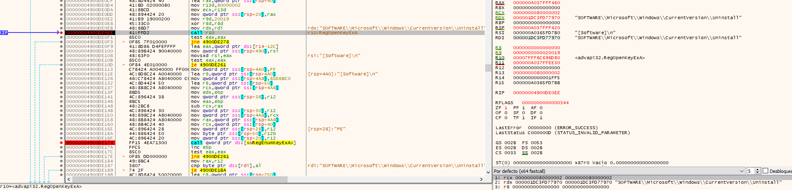
</p>

Based on the analyzed sample, Vidar was observed collecting data from multiple applications and services installed on the victim's system, in addition to the previously gathered system information. The targeted sources identified during the analysis include:

- **Steam:**  
  Vidar collects Steam-related information from the registry location:
  - `Software\Valve\Steam`
- **FileZilla:**  
  Server configurations are targeted.

- **Discord:**  
  The malware extracts information stored by the Discord application from:
  - `%APPDATA%\Discord`

- **WinSCP:**  
  Stored session information is targeted from the following registry locations:
  - `Software\Martin Prikryl\WinSCP 2\Sessions`
  - `\Registry\User\<SID>\Software\Martin Prikryl\WinSCP 2\Sessions`

- **Telegram:**  
  Local Telegram data and web-related information are targeted.

- **FTP/SSH clients:**  
  Stored credentials and session data from supported applications are collected.

- **Azure:**  
  Configuration files stored in the Azure directory are targeted:
  - `C:\Users\<user>\.azure`

- **Chromium-based applications:**  
  Vidar accesses Chrome's Local Storage LevelDB database located at:
  - `C:\Users\<user>\AppData\Local\Google\Chrome\User Data\Default\Local Storage\leveldb\`

  Within these files, the malware searches for specific account-related identifiers:
  - `account1`
  - `account5`
  - `account6`
  - `account7`
  - `account8`
  - `account9`

- **Screenshots:**  
  Vidar is capable of capturing screenshots from the victim's system using Windows graphical APIs provided by `gdi32.dll`.

Once Vidar recollects all the information, it creates files with the follow pattern `[a-z0-9]{8}`. Browser-related artifacts, such as credentials, browsing history, cookies, and other user data, are extracted from SQLite databases located within the browser profile directories. The collected data is then staged into these temporary files.
<p align="center">
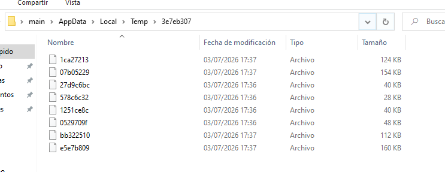
</p>

Finally, Vidar organizes all the collected information and establishes communication with the C2 server to exfiltrate the gathered data. The C2 response also contains information about the next-stage loader that will be downloaded and executed.
<p align="center">
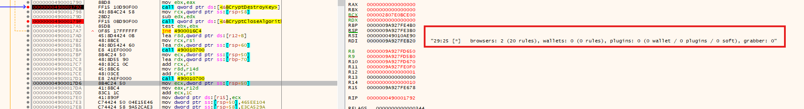
</p>
<p align="center">
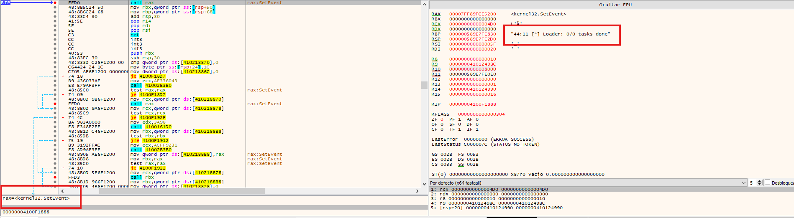
</p>

## Further Insights
Based on the sample I analyzed, two features were not present but are known to be supported by Vidar: the `Grabber` and the `Loader`.

The `Grabber` allows the operator to define custom file paths through the Vidar control panel. These paths are included in the configuration file, which is downloaded by the malware when it executes. Once the configuration is retrieved, the Grabber collects the files located in the specified directories and exfiltrates them along with the rest of the stolen data.

The `Loader` is responsible for retrieving an additional payload from a remote URL and executing it on the compromised system, enabling the next stage of the attack.

>For more detailed, see the excellent technical analysis published by Cynet:
>
> **[Cynet CyOps Lighthouse – Vidar Stealer](https://www.cynet.com/blog/cyops-lighthouse-vidar-stealer/)**

## Intel
During the investigation, I attempted to identify and analyze panels associated with the most recent Vidar versions, as they could provide valuable insight into the malware's current functionality and infrastructure. However, only older panel versions were available, and these had already been documented in previous research conducted by other analysts. 
<p align="center">
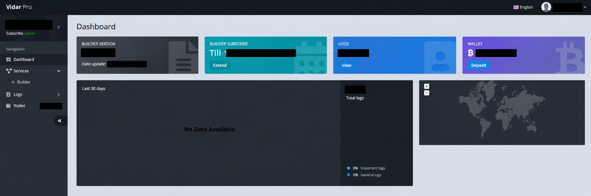
</p>

Continuing my research into these panels, I came across several archived websites advertising Vidar as a commercial product. Based on the available information, customers purchased access to the service, which included a subscription for a limited period. Once the subscription expired, it had to be renewed through an additional payment in order to continue using the service and receive updates.
<p align="center">
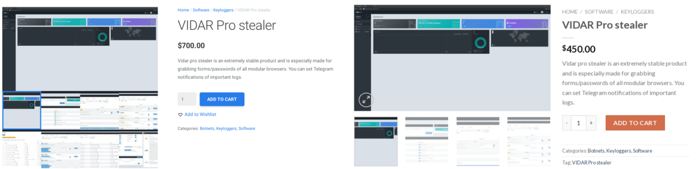
</p>

## Sandboxes
The following public sandbox reports were used during the analysis:

- 🔍 **ANY.RUN** – [Task 1](https://app.any.run/tasks/20200991-f35b-4985-93e5-2c65ad8ad943)
- 🔍 **ANY.RUN** – [Task 2](https://app.any.run/tasks/d2bbd89b-8b19-42b6-a0d7-b6f3ba26f0ee)
- 🔍 **ANY.RUN** – [Task 3](https://app.any.run/tasks/3acd012e-feed-4b14-a8ec-0c25aa57918f)
- 🔍 **ANY.RUN** – [Task 4](https://app.any.run/tasks/d57afa8a-0bf8-4b82-a718-b161465452c8)
- 🔍 **ANY.RUN** – [Task 5](https://app.any.run/tasks/2119aae0-cb36-4fa2-aa8b-baf8fa96ac9c)
- 🧪 **Joe Sandbox** – [Task6](https://www.joesandbox.com/analysis/1936581/0/html)
- 🧪 **Joe Sandbox** – [Task7](https://www.joesandbox.com/analysis/1933536/0/html)

## Detection opportunities
* [TA0002][T1059.001] Powershell execution<br>
``` powershell -w -h "iex(<redacted>)"```
* [TA0009][T1074] Data Staged: Local Data Staging<br>
```C:\Users\<User>\AppData\Local\Temp\[a-z0-9]{8}```
* [TA0005][T1480.002] Execution Guardrails: Mutual Exclusion
```
(Registry) *\Software\Microsoft\Windows\CurrentVersion\Explorer
(Key) TS_aa6f515d
```

## TTP
[TA0002][T1204.004] User Execution: Malicious Copy and Paste<br>
[TA0002][T1059.001] Powershell<br>
[TA0002][T1204] User Execution<br>
[TA0005][T1027] Obfuscated Files or Information<br>
[TA0005][T1055] Process Injection<br>
[TA0005][T1480.002] Execution Guardrails: Mutual Exclusion<br> 
[TA0005][T1620] Reflective Code Loading<br>
[TA0006][T1555] Credentials from Password Stores<br>
[TA0006][T1539] Steal Web Session Cookie<br>
[TA0007][T1033] System Owner/User Discovery<br>
[TA0007][T1057] Process Discovery<br>
[TA0007][T1082] System Information Discovery<br>
[TA0007][T1217] Browser Information Discovery<br>
[TA0009][T1074] Data Staged: Local Data Staging<br>
[TA0009][T1005] Data from Local System<br>
[TA0010][T1041] Exfiltration Over C2 Channel<br>
[TA0011][T1071] Application Layer Protocol<br>
[TA0040][T1657] Financial Theft<br>


## Indicators of Compromise (IOCs)
### SHA256 Hashes
ac1a4d8a2c2bf91b75c4c173424b4b142ef29aa7356ee9e05f043e4faeab94dd - setup-1.5.exe
23E0142B4D892D05672084FD9A21DD9678EEEFDFB784AA95246792D5D8EAAF05 - Xeno.exe
4992CB5F29594AE1CEA78E028A2E6A51D571A610CEEB4442B605953B916DD1C4 - 0c086e9dec2646afaae25a4d6d279141.exe
96088102f4063e528e214d3b9021bf7210a5bac500693d762023b12dbca5376b - FPS BOOST.exe
12955F7DAEE85630142452182DAED5BE40AA628CC1B75CC81BD19E452660770F - Clickfix.exe
96a6875c5ef401924adc9370e83d058e1bb23a4299582802ea30089df5dc7fb6 - Loader.exe

### Domains
159[.]69.100.23<br>
167[.]233.158.81<br>
91[.]98.111.49<br>
telegram[.]me/w09ksp<br>
bdm.omni-signage[.]com<br>
https://juj.psgiran.news/<br>
telegram[.]me/af97ri<br>
159.69.77.223
